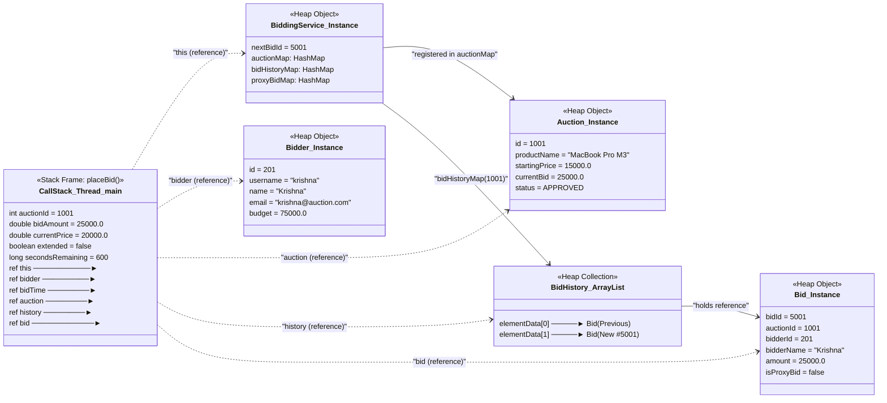

# Day 10: Memory Management — Online Auction System

This project forms part of the Java training tasks for **Day 10**, focusing on Java memory architecture, garbage collection behavior, common memory pitfalls, and an in-depth memory review of the **Online Auction System**.

---

## 1. Overview & Objectives

Day 10 investigates the inner workings of the JVM memory subsystem:
1. **JVM Memory Architecture (Stack vs. Heap):** How thread stacks store primitive local variables and object references within stack frames, while the shared Heap stores all object instances and arrays.
2. **Memory Lab Experiments (5 Core Experiments):**
   - **Experiment 1 (StackOverflowError):** Measuring maximum recursive call depth under different thread stack sizes (`-Xss256k` vs `-Xss1m`).
   - **Experiment 2 (OutOfMemoryError):** Observing heap exhaustion and GC root retention under restricted heap limits (`-Xmx64m`).
   - **Experiment 3 (String vs. StringBuilder):** Measuring runtime performance and temporary object thrashing between immutable `String +=` and mutable `StringBuilder.append()`.
   - **Experiment 4 (Garbage Collection Basics):** Analyzing live HotSpot G1 GC logs with `-Xlog:gc` to observe Young GC, reachability, and `System.gc()` Full GC behavior.
   - **Experiment 5 (Boxed Integer Cache):** Demonstrating the pitfalls of using `==` versus `.equals()` on boxed `Integer` wrapper objects inside and outside the [-128, 127] cache range.
3. **Project Memory Review:** Auditing real auction services for unbounded collections, unclosed resources, and memory leaks.
4. **Stack & Heap Business Diagram:** Visualizing runtime memory layout for the `BiddingService.placeBid()` method using Mermaid.

---

## 2. Project Structure

```text
Day-10/day10-memory-management/
├── pom.xml
├── README.md                               <-- Day 10 documentation & Mermaid diagram
├── project-memory-review.md                <-- Memory audit & remediation notes
├── results/
│   └── memory-lab-results.md              <-- Full lab results table & raw JVM outputs
└── src/
    ├── main/java/com/auction/
    │   ├── lab/
    │   │   ├── MemoryLabRunner.java        <-- Interactive launcher
    │   │   ├── StackOverflowExperiment.java<-- Exp 1: Stack frame recursion
    │   │   ├── OutOfMemoryExperiment.java  <-- Exp 2: Retained heap arrays (-Xmx64m)
    │   │   ├── StringVsStringBuilderExperiment.java <-- Exp 3: += vs StringBuilder
    │   │   ├── GarbageCollectionExperiment.java     <-- Exp 4: Reachability & -Xlog:gc
    │   │   └── IntegerCacheExperiment.java          <-- Exp 5: Integer cache & == pitfall
    │   ├── model/                          <-- Domain entities (Auction, Bid, User, etc.)
    │   ├── service/
    │   │   ├── BiddingService.java         <-- Core bidding logic (with proxy cleanup)
    │   │   ├── AuditService.java           <-- Bounded audit log (FIFO eviction)
    │   │   └── ...
    │   └── ...
    └── test/java/com/auction/
        ├── lab/
        │   └── MemoryLabTest.java          <-- Automated JUnit 5 tests for lab concepts
        └── service/
            ├── AuditServiceMemoryTest.java  <-- Bounded memory policy test
            └── BiddingServiceTest.java     <-- FR4-FR6 bidding logic tests
```

---

## 3. How to Compile and Run the Experiments

### Build the Project with Maven
```bash
mvn test-compile
mvn test
mvn package
```

### Run Experiment 1: StackOverflowError Depth
```bash
# Test with 256k stack size
java -Xss256k -cp target/classes com.auction.lab.StackOverflowExperiment

# Test with 1m stack size
java -Xss1m -cp target/classes com.auction.lab.StackOverflowExperiment
```

### Run Experiment 2: OutOfMemoryError (Java Heap Space)
```bash
# Run with a bounded 64 MB heap
java -Xms16m -Xmx64m -cp target/classes com.auction.lab.OutOfMemoryExperiment
```

### Run Experiment 3: String += vs StringBuilder.append()
```bash
# Run 15,000 concatenation benchmark
java -cp target/classes com.auction.lab.StringVsStringBuilderExperiment 15000
```

### Run Experiment 4: Garbage Collection Basics with GC Logging
```bash
# Run with unified JVM GC logging enabled
java -Xlog:gc -cp target/classes com.auction.lab.GarbageCollectionExperiment
```

### Run Experiment 5: Boxed Integer Cache (== vs equals)
```bash
# Run Integer cache equality test
java -cp target/classes com.auction.lab.IntegerCacheExperiment
```

### Interactive Runner
```bash
java -jar target/day10-memory-management-1.0-SNAPSHOT.jar
```

---

## 4. Summary of Memory Lab Results

All experiments were executed on **Java 27 (HotSpot 64-Bit Server VM)**. Complete logs are saved in [results/memory-lab-results.md](results/memory-lab-results.md).

| Experiment | Command / Flag | Actual Result | Observation & Conclusion |
|---|---|---|---|
| **1. StackOverflowError** | `-Xss256k`<br>`-Xss1m` | Depth: **1,541** frames<br>Depth: **13,959** frames | Stack depth scaled ~9x with a 4x increase in stack allocation. Unbounded recursion exhausts stack memory rapidly. |
| **2. OutOfMemoryError** | `-Xms16m -Xmx64m` | Exhausted at **31 chunks (~31 MB retained)** | Objects strongly referenced in an `ArrayList` act as GC roots; GC cannot reclaim reachable memory, leading to `OutOfMemoryError`. |
| **3. String vs StringBuilder** | Default (15k iterations) | String: **27.95 ms**<br>StringBuilder: **0.80 ms** (~34.8x faster) | Immutability causes $O(N^2)$ character array copies on repeated concatenation. `StringBuilder` appends in amortized $O(1)$. |
| **4. Garbage Collection** | `-Xlog:gc` | Young GC: `5M->1M(10M)` in 1.8ms<br>System.gc(): `28M->1M(102M)` in 5.9ms | Unreferenced temporary objects in Eden are cleared during Minor GC. Once references are dropped (`list = null`), Full GC reclaims the retained payload. |
| **5. Integer Cache** | Default | `100 == 100`: **true**<br>`1000 == 1000`: **false** | JLS §5.1.7 caches wrapper objects between -128 and 127. Outside this range, `==` fails because it compares heap references instead of numeric values. |

---

## 5. Stack and Heap Diagram for `BiddingService.placeBid()`

Below is a visual representation of the Java memory layout during the execution of a business method in our auction system: `BiddingService.placeBid(auctionId, bidder, bidAmount, bidTime)`.



### Diagram Explanation in Simple Student Language

1. **The Stack Frame:**
   - When thread `main` calls `biddingService.placeBid(...)`, the JVM pushes a **stack frame** for this method onto the thread's call stack.
   - Primitive local variables (`int auctionId`, `double bidAmount`, `double currentPrice`, `boolean extended`) and loop counters are held directly within this stack frame.
   - For objects, the stack frame stores only **reference variables** (memory addresses pointing to where the real objects live on the heap), such as `bidder`, `auction`, `history`, and `bid`.

2. **The Heap Space:**
   - All actual objects (`Bidder`, `Auction`, `Bid`, `ArrayList`, and `HashMap`) reside in the **Heap**.
   - Multiple references can point to the same heap object. For example, both the local variable `auction` in the stack frame and the key-value entry in `auctionMap` point to the exact same `Auction` object.
   - When `auction.setCurrentBid(bidAmount)` is executed, the field inside the heap object is updated. Any other thread or method accessing that object immediately sees the updated price.

3. **Garbage Collection Reachability:**
   - As long as `placeBid()` is running, the local references on the stack frame act as **GC Roots**.
   - Once `placeBid()` completes and returns `BidResult`, its stack frame is popped and discarded.
   - However, the newly instantiated `Bid` object is NOT collected by GC because it was added to `history.add(bid)`, which is held by `bidHistoryMap` inside `BiddingService`. Because `BiddingService` remains alive, the new `Bid` remains reachable and safe.
   - Note: In modern HotSpot JVMs, optimizations like escape analysis and scalar replacement may allocate non-escaping objects directly in CPU registers or stack frames, so not every concept is guaranteed to allocate physical heap nodes under all execution profiles.

---

## 6. Project Memory Review Highlights

See full details in [project-memory-review.md](project-memory-review.md):

- **AuditService Bounded Memory Policy:** Previously, `AuditService` accumulated audit records endlessly in an `ArrayList`. Fixed by adding `DEFAULT_MAX_CAPACITY = 500` with FIFO eviction (`records.remove(0)`) to ensure the audit log cannot cause a heap leak during extended operation.
- **Scanner Resource Management:** Identified unclosed `Scanner` streams in interactive CLI runners; ensured proper lifecycle closure.
- **Proxy Tracking Cleanup:** Added `clearProxyLimits(auctionId)` to `BiddingService` to release transient auto-bidding maps when an auction ends, while strictly preserving permanent bid history.
- **Primitive vs. Wrapper Consistency:** Confirmed all domain IDs (`auctionId`, `bidderId`, `bidId`) use primitive `int` values, completely avoiding boxed `Integer` cache identity issues.
